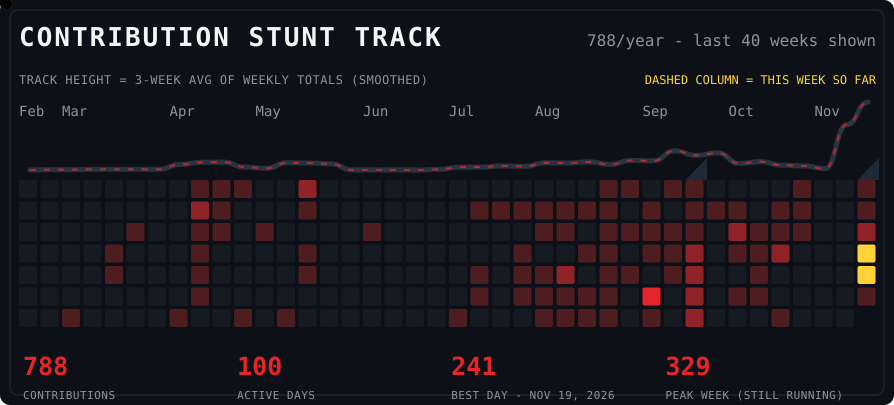
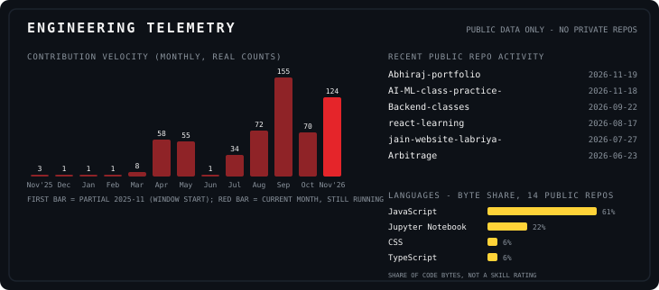

<picture>
  <source media="(prefers-color-scheme: dark)" srcset="assets/graphs/stunt-track-dark.svg">
  <source media="(prefers-color-scheme: light)" srcset="assets/graphs/stunt-track-light.svg">
  
</picture>

## About

I'm Abhi (Abhiraj Jain), a second-year B.Tech Computer Science (AI & ML) student at Vedam School of Technology, Pune. I treat college as a launchpad: I design, build and ship working products instead of only coursework. My main work right now is NioLearn, a live education platform, and EduOS, a multi-tenant school operating system. I write TypeScript, Java, Python and SQL, and I work across Next.js, React, Node, PostgreSQL and Supabase.

## Missions

### NioLearn — live product
An outcome-focused education and college guidance platform for Indian students, live at [niolearn.com](https://niolearn.com/). I am co-founder and CTO. The platform has a public marketing site, a college discovery engine with institutional profiles and comparison tools, and an internal admin panel for operations. It is a pnpm + Turborepo monorepo of three Next.js apps with shared UI, auth, database, types and validation packages, on PostgreSQL via Supabase, with Razorpay payments. Enrollment activates only on captured payments; authorized-but-uncaptured stays pending. The first paid cohort is planned (not yet running). Repository is private, so the link goes to the live product.

### EduOS — engineering case study (private repo)
A multi-tenant K-12 school operating system, designed as a modular monolith in a pnpm + Turborepo monorepo. Five apps (school portal, platform console, public admissions site, API gateway, async worker) and seven shared packages, with strict tenant isolation through tenant_id scoping and Postgres row-level security, capability-based access control, SQL migrations and architecture decision records. I lead product and technicals. Built modules so far include identity, admissions and the full admission-to-student lifecycle with an automated test suite. The repo is private, so this is a case study, not a link.

### GitHub Analyser — public repo + deployed app
A developer analytics dashboard that turns any GitHub profile into charts and a score: language distribution, top repositories, activity graphs and a 12-month contribution heatmap through GitHub's GraphQL API. React and Chart.js on the front, API calls routed through a serverless function. Built and deployed with my own commits.

- App: [git-hub-analyser.vercel.app](https://git-hub-analyser.vercel.app)
- Code: [github.com/Jainabhi90/GitHub-Analyser](https://github.com/Jainabhi90/GitHub-Analyser)

### Fnatics — 24-hour hackathon, Team Fnatics
An AI-assisted DSA learning platform built during a 24-hour hackathon at Vedam with Team Fnatics. It tracks topic mastery across DSA areas, daily streaks, weak vs strong topics and gives difficulty-aware question recommendations, with a live leaderboard. React + Vite, Firebase Auth and Firestore, Tailwind + shadcn/ui, Recharts. Team project; my fork: [github.com/Jainabhi90/Fnatics-project-](https://github.com/Jainabhi90/Fnatics-project-) (original team repo under a teammate's account).

## Engineering telemetry

<picture>
  <source media="(prefers-color-scheme: dark)" srcset="assets/graphs/telemetry-dark.svg">
  <source media="(prefers-color-scheme: light)" srcset="assets/graphs/telemetry-light.svg">
  
</picture>

## More things I've built

- **Insta-CRM** — an Instagram CRM concept: multi-account management, automated DM/comment workflows, lead tracking and analytics, OAuth 2.0. [repo](https://github.com/Jainabhi90/Insta-CRM)
- **ArbDetector** — a scanner that matches equivalent markets across Kalshi and Polymarket and surfaces fee-adjusted arbitrage opportunities, with a dashboard and Telegram alerts. [repo](https://github.com/Jainabhi90/Arbitrage)
- **Labriya Chaturmas Portal** — a full community portal for a Jain temple: schedules, Panchang, events, donations and an admin console. Next.js 15 + Supabase on Vercel. [repo](https://github.com/Jainabhi90/jain-website-labriya-)
- **Vedam CGPA Calculator** — a merit score and CGPA calculator for my college's evaluation structure (work in progress). [repo](https://github.com/Jainabhi90/CGPA-Calculator-Vedam)

## Beyond code

- Head of Offline Marketing, NOESIS 2.0 (Vedam tech festival, planned for Jan 29–30, 2027). I wrote the offline marketing strategy: 40–45 colleges planned for physical outreach visits plus digital and community channels. These are plan targets, not results.
- Core Committee Member, NOESIS 2026 (the festival's first edition, Feb 2026).
- Finance Head, Sports Club, and Core Committee, Open Source Club at Vedam.
- State-level badminton player.

Education quick facts

B.Tech CSE (AI & ML), Vedam School of Technology, batch 2025–2029. First-semester CGPA 9.13. Qualified JEE Advanced and BITSAT; VITEEE rank 4,570. Class 12 ~94%, Class 10 97.6% (school topper).

## Connect

- Email: jainabhi90980@gmail.com
- NioLearn: [niolearn.com](https://niolearn.com/)
- GitHub: [github.com/Jainabhi90](https://github.com/Jainabhi90)
