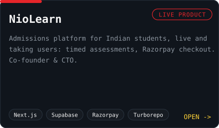
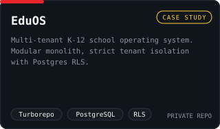
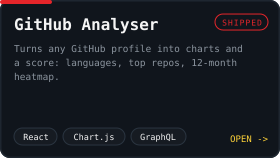
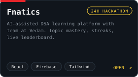
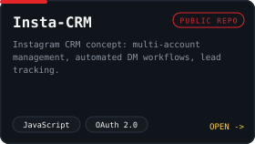
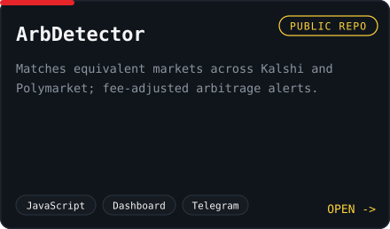
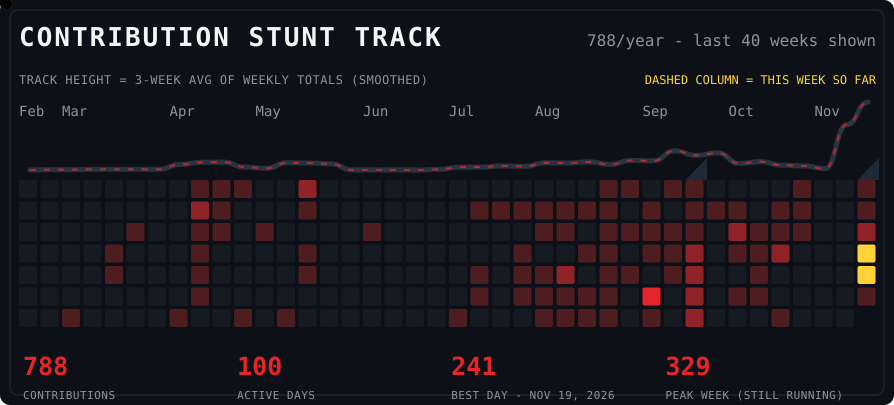
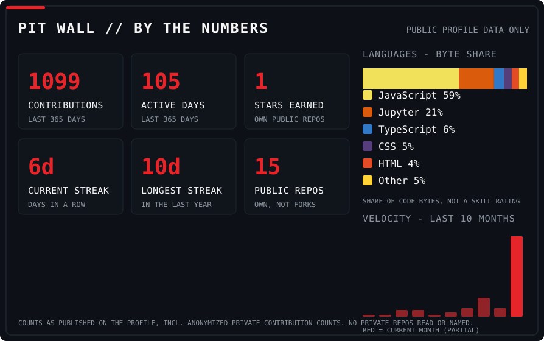
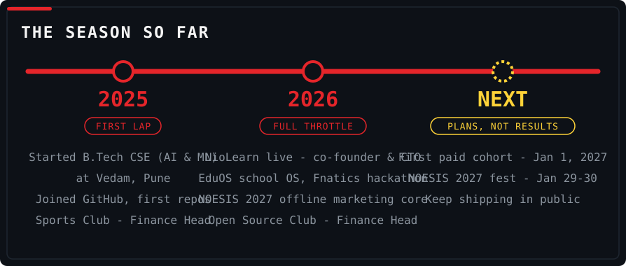

## 🏁 Featured Missions

     

Also built: [Labriya Chaturmas Portal](https://github.com/Jainabhi90/jain-website-labriya-) (temple community portal, Next.js 15 + Supabase) · [Vedam CGPA Calculator](https://github.com/Jainabhi90/CGPA-Calculator-Vedam) (work in progress)

<picture>
  <source media="(prefers-color-scheme: dark)" srcset="assets/graphs/stunt-track-dark.svg">
  <source media="(prefers-color-scheme: light)" srcset="assets/graphs/stunt-track-light.svg">
  
</picture>

## 🛠️ Tech Deck

<picture>
  <source media="(prefers-color-scheme: dark)" srcset="https://skillicons.dev/icons?i=ts,js,py,java,html,css&theme=dark">
  <source media="(prefers-color-scheme: light)" srcset="https://skillicons.dev/icons?i=ts,js,py,java,html,css&theme=light">
  
</picture>
<picture>
  <source media="(prefers-color-scheme: dark)" srcset="https://skillicons.dev/icons?i=react,nextjs,nodejs,express,tailwind,vite&theme=dark">
  <source media="(prefers-color-scheme: light)" srcset="https://skillicons.dev/icons?i=react,nextjs,nodejs,express,tailwind,vite&theme=light">
  
</picture>
<picture>
  <source media="(prefers-color-scheme: dark)" srcset="https://skillicons.dev/icons?i=postgres,supabase,firebase,vercel,git,github&theme=dark">
  <source media="(prefers-color-scheme: light)" srcset="https://skillicons.dev/icons?i=postgres,supabase,firebase,vercel,git,github&theme=light">
  
</picture>

<picture>
  <source media="(prefers-color-scheme: dark)" srcset="assets/graphs/stats-dark.svg">
  <source media="(prefers-color-scheme: light)" srcset="assets/graphs/stats-light.svg">
  
</picture>

<picture>
  <source media="(prefers-color-scheme: dark)" srcset="assets/graphs/timeline-dark.svg">
  <source media="(prefers-color-scheme: light)" srcset="assets/graphs/timeline-light.svg">
  
</picture>

## 🎙️ About

Second-year B.Tech CSE (AI & ML) student at Vedam School of Technology, Pune. College is my launchpad: I design, build and ship real products. Right now that's **NioLearn** (live) and **EduOS**. State-level badminton player off the track.

Education quick facts

B.Tech CSE (AI & ML), Vedam School of Technology, batch 2025–2029. First-semester CGPA 9.13. Qualified JEE Advanced and BITSAT; VITEEE rank 4,570. Class 12 ~94%, Class 10 97.6% (school topper).

## 📡 Connect

