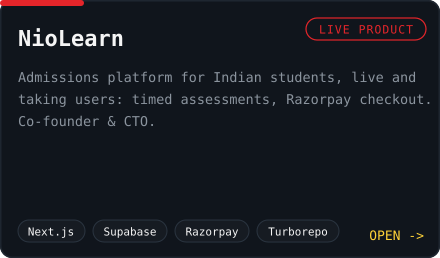
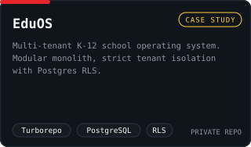
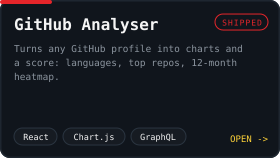
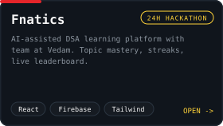
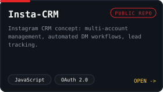
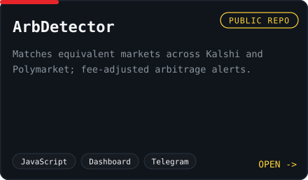
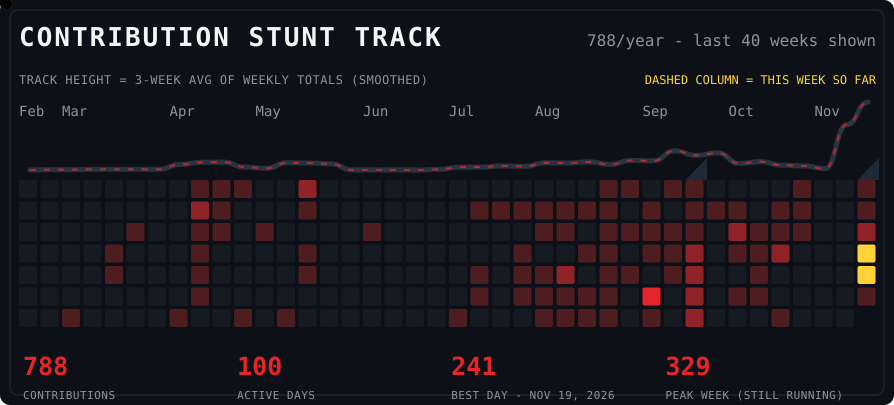
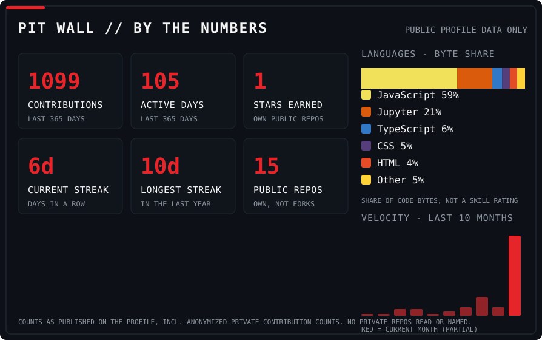
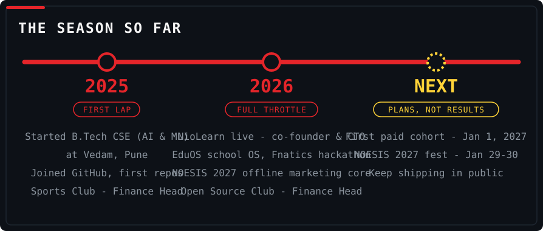

## 🎙️ About

I'm a second-year B.Tech CSE (AI & ML) student at Vedam School of Technology, Pune (batch 2025-2029). College is my launchpad: instead of stopping at coursework, I design, build and ship real products that people actually use.

Right now that's **NioLearn** - an admissions platform for Indian students, live and taking users, with timed assessments and Razorpay checkout. I build it as co-founder & CTO. Behind it is **EduOS**, a multi-tenant K-12 school operating system with strict tenant isolation. My public repos include **GitHub Analyser** (turns any GitHub profile into charts and a score), **Fnatics** (AI-assisted DSA practice, built at Vedam's 24-hour hackathon, which I co-organized), a temple community portal and a CGPA calculator for my college.

Off the editor, I run things too: Finance Head of the Sports Club (2025-26), Finance Head of the Open Source Club (2026-27), and offline marketing core for NOESIS 2027, our tech fest. State-level badminton player when I'm not shipping.

Open to software engineering opportunities and interesting collaborations.

Education quick facts

B.Tech CSE (AI & ML), Vedam School of Technology, batch 2025–2029. CGPA 8.95/10 (9.13 first semester). JEE Main 91.56 percentile; qualified JEE Advanced and BITSAT; VITEEE rank 4,570. Class 12 ~94%, Class 10 97.6% (school topper). 150+ LeetCode problems solved, mostly in Java.

## 🏁 Featured Missions

     

Also built: [Labriya Chaturmas Portal](https://github.com/Jainabhi90/jain-website-labriya-) (temple community portal, Next.js 15 + Supabase) · [Vedam CGPA Calculator](https://github.com/Jainabhi90/CGPA-Calculator-Vedam) (work in progress)

<picture>
  <source media="(prefers-color-scheme: dark)" srcset="assets/graphs/stunt-track-dark.svg">
  <source media="(prefers-color-scheme: light)" srcset="assets/graphs/stunt-track-light.svg">
  
</picture>

## 🛠️ Tech Deck

  
  
  
  
  
  

  
  
  
  
  
  

  
  
  
  
  
  
  
  

<picture>
  <source media="(prefers-color-scheme: dark)" srcset="assets/graphs/stats-dark.svg">
  <source media="(prefers-color-scheme: light)" srcset="assets/graphs/stats-light.svg">
  
</picture>

<picture>
  <source media="(prefers-color-scheme: dark)" srcset="assets/graphs/timeline-dark.svg">
  <source media="(prefers-color-scheme: light)" srcset="assets/graphs/timeline-light.svg">
  
</picture>

## 📡 Connect

